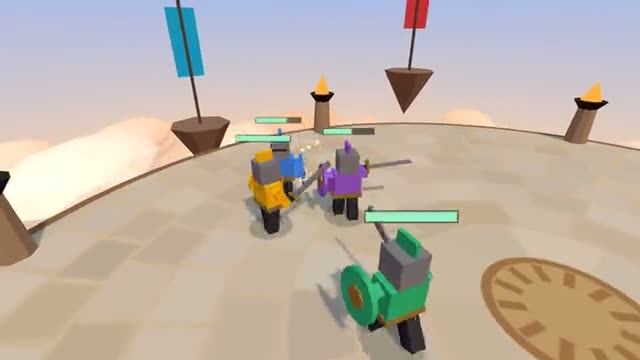

# Sword Arena

Swing, block, roll. Last knight standing scores. A multiplayer starter game from [Multiplayer Agent](https://multiplayeragent.com): 3D, versus, 2–6 players, with bots that fill empty seats.

## How it plays

Knights fight on a floating stone arena. Three swings in a row end in a big overhead hit, a raised shield stops a swing and leaves the attacker reeling, and a roll dodges anything. Knock a rival out or off the edge; first to 5 knockouts wins.

**Controls:** WASD and mouse, click to swing, hold right-click or Shift to block, Space to roll. On a phone: left thumb moves, drag to look, SWING, BLOCK and ROLL buttons.

## Make it yours in the Game Builder

Open the [Game Builder](https://multiplayeragent.com), choose **Start from a starter game** and pick Sword Arena. It opens as version 1 in your studio, ready to play and publish. Then ask for changes, for example:

- Give everyone a bow for a ranged attack
- Make the arena shrink as the match goes on
- Add a power-up that makes your sword huge

## Run it yourself

1. Get a free publishable key (`pk_…`) at [multiplayeragent.com](https://multiplayeragent.com).
2. In `index.html`, put it in place of `pk_REPLACE_ME` in the `MP_CONNECT` block.
3. Serve the folder (for example `npx serve`) and open it. The 3D engine loads as a module, which browsers block from a file on disk.

Without a key it still runs, offline against bots.

## How it is built

- One `index.html` plus three.js in `libs/`. The comment at the top of the script maps the code and explains the multiplayer. Swing timings, damage, block, roll and bot habits are all in `CONFIG`.
- **Leaderboard:** The most knockouts anyone has scored in one match.
- **Host-run rounds:** One player's browser counts the knockouts, runs the clock and calls the winner; if it leaves, the next player takes over.
- **Bots:** Bot knights circle, swing, block and roll until enough people join.
- **Live sync:** Every swing, block and roll shows up for everyone at once. The attacker's browser decides what its sword touched; the knight that was hit decides whether it rolled clear or blocked.
- `?attract` runs it offline with bots only and an orbiting camera. The preview video is recorded from it.

## License

MIT. three.js in `libs/` is MIT too (Copyright 2010-2024 three.js authors).
